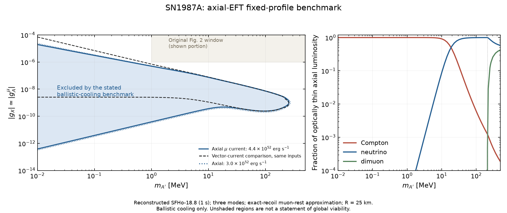
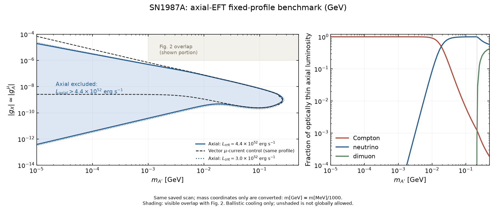

# Major 4.4：轴矢量 EFT 超新星冷却限制

2026-11-06。这里给出可复算的 **固定剖面、弹道能量逃逸（ballistic cooling）条件性限制**，以及正式回复信所用的图、数值和验证依据。该结果包含产生端和吸收/衰变截获端；它不是完整流体演化、扩散输运或所有超新星观测的联合排除。

## 1. 本次完成什么，结论是什么

本研究直接在轴矢量有效理论层面进行。采用纯轴矢量缪子流与两个活性中微子有效流，耦合归一化为：

\[
g_A^\mu=-g_X,\quad g_V^\mu=0,\quad
g_{\nu_\mu}=+g_X,\quad g_{\nu_\tau}=-g_X.
\]

没有引入 Major 3 的额外中微子场。原模型单 VEV 映射不变。这里的天体物理计算在 EFT 层面进行；径向标量等其他粒子的独立冷却效应不包含在本图中。

在重建的 SFHo-18.8、反弹后 1 s 剖面和以下近似下，\(L_{A'}>4.4\times10^{52}\) erg/s 的代表性区间为：

| 质量 MeV | 轴矢量产生端 \(|g_X|\) | 轴矢量截获端 \(|g_X|\) | 相同输入的矢量产生端 |
|---:|---:|---:|---:|
| 0.01 | 3.85e-13 | 1.96e-5 | 2.56e-9 |
| 1 | 3.84e-11 | 4.94e-7 | 2.50e-9 |
| 10 | 3.60e-10 | 7.47e-8 | 1.11e-9 |
| 100 | 2.38e-10 | 7.26e-9 | 2.39e-10 |
| 200 | 4.15e-10 | 2.86e-9 | 4.15e-10 |

质量端点在 255–260 MeV 之间；不赋予它超出剖面和近似精度的有效数字。图中填色严格对应上述标准；未着色不代表全局允许。



- [横版 PDF](outputs/axial_stellar_constraints.pdf)：独立比较图。
- [回复信竖排 PDF](outputs/axial_stellar_constraints_reply.pdf)：相同数据，提高在正文栏宽下的可读性。
- [GeV 单位对比版 PDF](outputs/axial_stellar_constraints_gev.pdf) / [PNG](outputs/axial_stellar_constraints_gev.png)：由同一组已保存扫描数据生成，只将质量坐标按 \(m_{A'}[\mathrm{GeV}]=m_{A'}[\mathrm{MeV}]/1000\) 转换；作为 Fig. 2 对照视图新增，不替换原来的 MeV 宽版图或回复信版图。 绘图范围仍覆盖 SN 扫描的 \(10^{-5}\)–\(0.5\) GeV；阴影只标示当前面板与 Fig. 2 展示窗口的可见交集，不代表重画 Fig. 2 的完整质量范围。


- [光度随耦合变化](outputs/luminosity_checks.pdf)：显示产生增加与截获抑制。
- [数值验证摘要](outputs/numerical_validation.json)、[验证与正式自审记录](VALIDATION_AND_REVIEW.md)。

## 2. 文献成果怎样使用

| 文献 | 采用内容 | 必须区分的条件 |
|---|---|---|
| [Liu–Miller 1705.01633](https://arxiv.org/html/1705.01633v1)，Eqs. (20), (34) | 精确真空矢量/轴矢量半康普顿核及逆过程归一化，电子质量替换为缪子质量 | 有限温热率和偏振逃逸须另算；没有采用 WW 近似 |
| [Alonso–Blas–Wolf 1810.00889](https://arxiv.org/html/1810.00889v2)，§5.1 | 轴矢量纵向模式与导数 ALP 相互作用的匹配 | 原电子/核子数值不直接当缪子限制 |
| [Gori et al. 2506.11191](https://arxiv.org/html/2506.11191v1)，§IV | 轴矢量 SN 估算中的纵向重标定和中微子逃逸条件 | 原核子源项须替换；说明已存在轴矢量研究 |
| [Bollig et al. 2005.07141v7](https://arxiv.org/html/2005.07141v7)及[勘误](https://doi.org/10.1103/PhysRevLett.126.189901) | 修正后的低质量 ALP–muon 标度交叉检查 | 使用 \(10^{-7.5}\) GeV\(^{-1}\)，不使用已被修正的 \(10^{-8.1}\)；不能据此推出截获端 |
| [Blinov et al. 2511.09619v2](https://arxiv.org/html/2511.09619v2)，App. B | 角平均、reduced opacity、速度因子、引力红移和逃逸能阈；原活性中微子过程 | 不复制其完整矢量曲线，不把其 LESN、扩散和高能中微子条件混为一个 cooling 条件 |
| [Caputo et al. 2109.03244v3](https://arxiv.org/abs/2109.03244v3)、[Ferreira et al. 2510.14469v1](https://arxiv.org/abs/2510.14469v1) | 公开图形中的 SFHo-18.8 热力学剖面和 lapse | 重建数据，不是原始模拟表；不同曲线须核对 |

详细 EFT 文献调查及 28 点纯 V、纯 A、V+A 振幅对照见[前一阶段记录](../stellar-cooling-eft-literature-20261105/README.md)。独立自旋子参考实现保存在 `research/stellar-cooling-eft-literature-20261105/reference_matrix_element.py`。

## 3. 速率、归一化和输运

`rates.py` 的所有返回值均为 **单位 \(g_X^2\)**，模态顺序为 L、+、−。质量、能量、温度、化学势以 MeV 表示；截面 MeV\(^{-2}\)，密度 MeV\(^3\)，率 MeV。电磁耦合 \(e^2\) 已包含。

1. **逆半康普顿** \(\mu A'\to\mu\gamma\)：在介质静止系取入射缪子静止，保留精确两体反冲，独立计算三个 mediator 偏振。只平均缪子自旋，不平均 mediator 模态。真空偏振求和与 Liu–Miller 的 crossed kernel 相符。乘以出射光子的 \(1+f_B(\omega_\gamma)\)，再乘 \(n_\mu^{\rm eff}=2\sum_{\mu^-,\mu^+}\int d^3p/(2\pi)^3 f(1-f)\)。该有效密度近似没有保留真实散射前后缪子动量关联；不能称作精确移动缪子热积分。
2. **中微子合并/衰变**：每味真空宽度 \(g_X^2M/(24\pi)\)，两味相加。保留 Fermi 分布、阻塞和 \(\mu_{\nu_\mu}(r)\)，取 \(\mu_{\nu_\tau}=0\)。归一化角权重 \(W_L=3(1-z^2)/4\)、\(W_\pm=3(1\pm z)^2/8\)。化学势不为零时两个横向圆偏振率可以不同。
3. **双缪子合并/衰变**：\(M>2m_\mu\) 时保留，轴矢量宽度 \(g_X^2M\beta^3/(12\pi)\)。对照矢量为 \(g_X^2M\beta(1+2m_\mu^2/M^2)/(12\pi)\)。保留有限质量角分布和阻塞。

热平衡要求 \(\Gamma_h^{\rm prod}=e^{-\omega/T}\Gamma_h^{\rm abs}\)，这里是 **mediator 能量**，不是出射光子能量。输运用 \(\Gamma_h^{\rm red}=(1-e^{-\omega/T})\Gamma_h^{\rm abs}\)。完整光度公式见正式回复 Major 4.4；代码为

\[
L=\sum_h\int 4\pi r^2dr\,N^2
\int_{M/N}^{\infty}d\omega\frac{k\omega^2}{2\pi^2}
\Gamma_h^{\rm prod}\left\langle e^{-\int ds\,\Gamma_h^{\rm red}/v}\right\rangle_{\cos\theta}.
\]

从发射点沿完整直线弦到 \(R_\nu=25\) km，包含初始向内方向。偏振求和在指数外。沿弦固定局部能量，是指定的 leading-gravity prescription，不是完整 GR 轨道计算。长度换算为 \(1\,{\rm km}=10^{18}/197.3269804\,{\rm MeV}^{-1}\)，功率换算为 \(1\,{\rm MeV}^2=(1.602176634\times10^{-6})/(6.582119569\times10^{-22})\) erg/s。

`surface_blackbody_erg_s` 是强截获极限的表面诊断值。极强耦合下固定径向网格不能解析无限薄表层，数值 L 会下溢；不把这一数值下溢解释为物理零光度。25 km 表面的三模态黑体上限约为 8.7e51 erg/s，低于冷却标准；图的截获边界在收敛检查中单独核查。

## 4. 剖面来源及不确定性

`extract_profile.py` 从两个公开 arXiv source 包中只读取命名的 PDF 图；不接触受限模拟表。PDF 哈希、路径号、坐标变换和样点在 [profile_provenance.json](data/profile_provenance.json) 中。

- 基准 T、\(\mu_\mu\)、\(\mu_{\nu_\mu}\) 来自 Caputo Fig. 1 的矢量路径；T 在图框外仍有编码顶点，直接使用至 25 km，不拟合温度尾。
- \(\mu_\mu\) 在末端低于图示 1 MeV 后设零；未在对数图中解析的 \(|\mu_{\nu_\mu}|<1\) MeV 区段设零。内核第一个 0.116 km 点向内作常数延拓。
- lapse 来自 Ferreira 的 SFHo 橙色曲线至 24 km；24–25 km 用匹配的 Schwarzschild 外部形式续接。
- T 的跨图最大差约 0.27%。由 T、\(\mu_\mu\) 反算的缪子密度在 0、5、8、10、15 km 与独立密度曲线相差约 0.5%–1.1%。
- Ferreira 同名剖面的 \(\mu_\mu\) 曲线与 Caputo 明显不一致，保留在 CSV 中作诊断，**未作为本次基准输入**。没有把这个不一致宣称为原论文错误，也没有用它定义统计误差。

三通道计算未包括 muon–proton bremsstrahlung、完整介质光子色散、缪子热运动积分、额外媒介/标量通道或强耦合对 SN 剖面的反馈。修改 rate×1/2、×2 是诊断，不是这些遗漏的替代计算或置信带。固定剖面结果的高耦合端不裁决扩散输运、LESN 或高能中微子限制。

## 5. 数值与物理对照

图中下方面板的通道占比定义为
\[
f_i^{\rm thin}=\frac{L_i^{\rm thin}}{\sum_j L_j^{\rm thin}},
\]
即各通道对**光学薄极限轴矢量产生光度**的贡献比例。它们是在逃逸衰减/吸收截获之前定义的产生端诊断量，不是经过完整传播后的实际逃逸光度占比。

- 轴矢量在 10 MeV 的薄极限半康普顿份额为 91.4%，中微子约 8.6%；100 MeV 时中微子约 99.4%。因此向轴矢量外推矢量模型的 10 MeV 通道分界不成立。
- 低质量、\(3\times10^{52}\) erg/s 标准的产生端为 \(|g_A|\simeq3.2\times10^{-11}(M/{\rm MeV})\)，与修正后 \(\widehat g_{a\mu}=|g_A|/M\lesssim10^{-7.5}\) GeV\(^{-1}\) 的纵向匹配相符。
- 加密积分使已共同取样质量上的下边界变化小于 0.13%；最敏感的 10 keV 上边界从 1.96e-5 变为 2.10e-5（7.3%）。1–250 MeV 上边界最大变化约 0.26%。这是数值精度，不能代替物理系统误差。
- 低质量半康普顿 rate×1/2、×2 分别使产生端移动约 +41%、−29%。将源半径和逃逸半径一起改为 20 km，使 10 keV 上端移动约 1.93 倍，100 MeV 约 1.25 倍。
- 在取样点把 \(\mu_{\nu_\mu}\) 设零，边界变化不足 1%。能量截断由 \(M+1200\) 改为 \(M+1800\) MeV 的边界变化小于 0.02%。全部实际数值由 `validate_outputs.py` 汇总。

原 Fig. 2 显示 \(M\ge1\) MeV、\(g_X\ge10^{-6}\)。本图计算的 ballistic 排除带在其下方；这只能解释两图覆盖的耦合不同，不能据此声称原图内所有天体物理限制均不相关。

## 6. 复算

在仓库根目录执行；需要 Python、NumPy、SciPy、Matplotlib。重新提取源图另外需要 PyMuPDF。已验证版本见验证记录。

```powershell
python -m unittest discover -s research/stellar-cooling-constraints-20261105 -p test_*.py -v
python research/stellar-cooling-eft-literature-20261105/check_literature_kernels.py --matrix-script research/stellar-cooling-eft-literature-20261105/reference_matrix_element.py --output research/stellar-cooling-eft-literature-20261105/literature_kernel_validation.json
python research/stellar-cooling-constraints-20261105/run_scan.py --mass-count 68 --nr 88 --ne 180 --na 24 --ns 64 --nc 40 --gmax 1e-3 --gcount 301 --output research/stellar-cooling-constraints-20261105/outputs/axial.json
python research/stellar-cooling-constraints-20261105/run_scan.py --mass-count 68 --nr 88 --ne 180 --na 24 --ns 64 --nc 40 --gmax 1e-3 --gcount 301 --current vector --output research/stellar-cooling-constraints-20261105/outputs/vector.json
python research/stellar-cooling-constraints-20261105/run_scan.py --masses 250,255,260,265,270 --nr 88 --ne 180 --na 24 --ns 64 --nc 40 --gmax 1e-3 --gcount 301 --output research/stellar-cooling-constraints-20261105/outputs/endpoint.json
python research/stellar-cooling-constraints-20261105/validate_outputs.py
python research/stellar-cooling-constraints-20261105/plot_constraints.py
latexmk -pdf -interaction=nonstopmode -halt-on-error -outdir=latex-build Replies_to_Referee_3_referee_facing_2026-11-04.tex
```

PDF 经视觉核对并复制至根目录后，可运行 `python research/stellar-cooling-constraints-20261105/audit_reply.py`，重新生成本次源文件保留/引用/构建哈希审计。`outputs/reply_audit.json` 固定对应已提交 PDF 的那次构建；不同 TeX 环境或 PDF 时间戳可能改变二进制哈希。

敏感性/收敛扫描的质量、耦合与参数完整保存在各 JSON 中。`nr` 是径向目标阶数，按十个子区间向上取整：88、132、176 分别实际为 90、140、180 点。`ne` 是基础能量节点数，再加所有引力逃逸阈值；`na` 是发射方向积分，`ns` 是弦路径积分，`nc` 是半康普顿散射角积分。两个衰变角积分用 48 点。能量积分按线性插值积分并精确截在各半径的 \(M/N\)，耦合根按 log-log 插值。

`convergence.json`：nr132/ne280/na40/ns96/nc64；`refined_fast.json`：176/360/56/144/80；同取 0.01,0.1,1,10,100,200,250 MeV。`refined_low.json` 是优化前相同高阶扫描，保留作算法等价证据，边界相同；`pilot.json` 是较粗的探索记录，不用于最终图。半康普顿因子、R=20 km、零中微子化学势使用 `--compton-scale`、`--radius`、`--zero-numu`。截断扫描用 `--emax-offset 1800`，质量 0.01,1,100,250 MeV。

源图再提取命令和权利边界见 `extract_profile.py --help`。图中径向剖面数据及公开源图位置可供复算，但未分发原始受限模拟数据。

耦合网格复核 `coupling_refinement.json` 使用同一基准积分设置、1/250/255/260 MeV 和 `--gcount 1201`；与 301 点边界的最大差小于 0.3%。这项检查不修改主图输入，避免把不同扫描分辨率混作一个均匀网格。
