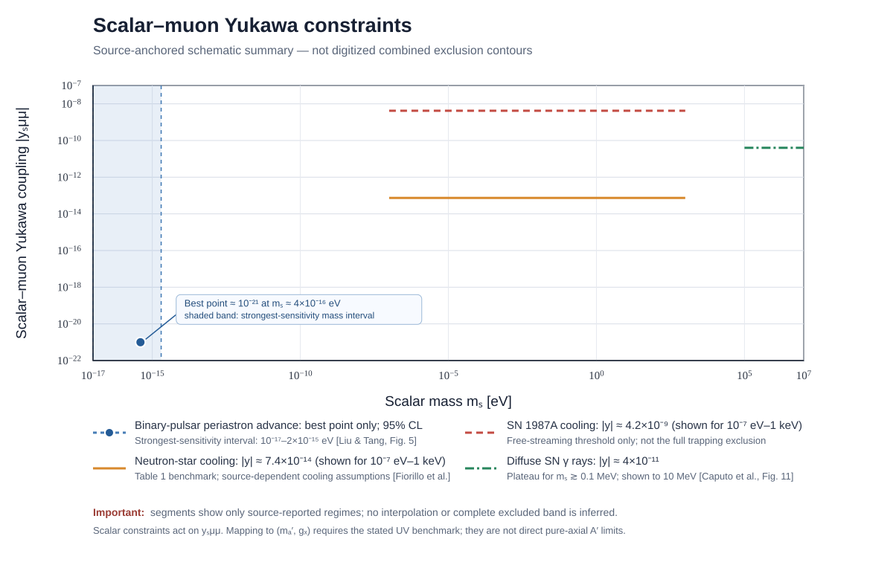

# Scalar–muon Yukawa constraints: source note

**Purpose.** This figure is a source-anchored schematic summary for the referee-response materials. It is deliberately **not** a digitized or globally combined exclusion contour. Horizontal segments show only explicit source-reported limits over stated mass regimes. The binary-pulsar entry shows the published best-sensitivity point and the interval in which the paper reports its strongest sensitivity; it is not a reconstructed continuous curve.

## Inputs shown

| Observable | What is plotted | Mass domain shown | Source and qualifications |
|---|---|---|---|
| Binary-pulsar periastron advance | Best point \(|y_{s\mu\mu}|\sim10^{-21}\) near \(m_s\simeq4\times10^{-16}\,\mathrm{eV}\); shaded interval marks strongest sensitivity, not a flat limit | \(10^{-17}\)–\(2\times10^{-15}\,\mathrm{eV}\) | Liu & Tang, *Phys. Rev. D* **112**, 055021 (2025), Fig. 5, [arXiv:2501.10927v2](https://arxiv.org/abs/2501.10927). Their calculation depends on neutron-star muon composition and includes backreaction of a long-range muonic force. |
| Neutron-star cooling | \\(|y_{s\\mu\\mu}|\\simeq7.4\\times10^{-14}\\) | \\(10^{-7}\\,\\mathrm{eV}\\lesssim m_s\\lesssim1\\,\\mathrm{keV}\\) (segment shown) | Fiorillo et al., *Neutron Star Bounds on Muonic Fifth Forces from Picometer to Kilometer Scales*, Table 1, [arXiv:2605.24094v2](https://arxiv.org/abs/2605.24094). This is the scalar entry in the paper's table for \\(m_X\\lesssim1\\,\\mathrm{keV}\\); the plotted segment is clipped to the mass interval where the source discusses the neutron-star-cooling regime and is not extrapolated to the broader, more approximate mass range in the abstract. |
| SN 1987A cooling | \\(|y_{s\\mu\\mu}|\\simeq4.2\\times10^{-9}\\) | \\(10^{-7}\\,\\mathrm{eV}\\lesssim m_s\\lesssim1\\,\\mathrm{keV}\\) (segment shown) | Fiorillo et al., Table 1, citing the conservative cold-SN calculation of Caputo et al. The plotted segment is restricted to the overlap \\(10^{-7}\\,\\mathrm{eV}\\lesssim m_s\\lesssim1\\,\\mathrm{keV}\\), rather than extrapolated into the ultralight long-range regime. This line is only a free-streaming cooling threshold; it does **not** encode the high-coupling trapping or explosion-energy branch and must not be interpreted as the full exclusion band. |
| Diffuse supernova gamma rays | \(|y_{s\mu\mu}|\simeq4\times10^{-11}\) plateau | \(0.1\)–\(10\,\mathrm{MeV}\) | Caputo, Raffelt & Vitagliano, *Phys. Rev. D* **105**, 035022 (2022), Fig. 11, [arXiv:2109.03244v3](https://arxiv.org/abs/2109.03244). The plotted plateau is the published approximate limit for \(m_s\gtrsim100\,\mathrm{keV}\); the paper's numerical curve uses its cold-SN reference model and cosmic core-collapse history. |

## Deliberate omissions

- The mass-dependent transition in the diffuse-supernova gamma-ray curve is not digitized; only the source-supported plateau is shown.
- The full SN 1987A cooling/trapping/explosion-energy exclusion is not drawn as one band. A single horizontal threshold would misrepresent its multiple regimes.
- Fifth-force constraints are not drawn as direct limits on \(y_{s\mu\mu}\), because their conversion uses loop-induced couplings to ordinary matter and depends on UV matching. Vector-mediator fifth-force curves are not transferred to a scalar without a scalar-specific calculation.
- The horizontal segments are not a combined “strongest bound” envelope. No interpolation between the sources is intended.
- The figure does not show direct constraints on the pure-axial \(A'\) current.

## UV translation

In the stated mass-proportional scalar benchmark,
\[
|y_{s\mu\mu}|=\frac{2|g_X|m_\mu}{m_{A'}}.
\]
A source bound \(|y_{s\mu\mu}|\le y_{\rm lim}(m_s)\) therefore maps, at fixed \(m_s\) and under this UV assumption, to
\[
|g_X|\le y_{\rm lim}(m_s)\frac{m_{A'}}{2m_\mu}
\simeq4.73\times10^{-3}\,y_{\rm lim}(m_s)\frac{m_{A'}}{\mathrm{MeV}}.
\]
This is a conditional UV translation, not a direct experimental limit on \(g_X\) or on the pure-axial \(A'\) effective current.

## Citation/figure provenance

- Liu & Tang: Fig. 5 (95% CL scalar-muon coupling constraints).
- Fiorillo et al.: Table 1 (scalar and vector muonic bounds; scalar value selected above).
- Caputo et al.: Fig. 11 (diffuse-SN-gamma-ray scalar Yukawa curve); their Fig. 2 shows the broader mass-dependent astrophysical constraints and the distinct SN1987A/trapping regimes.
